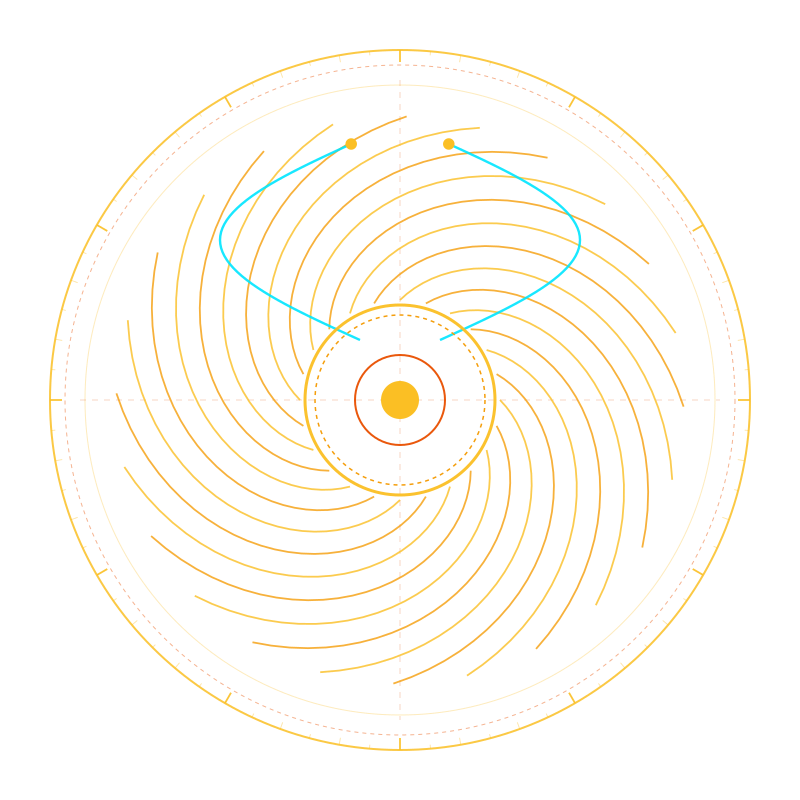

<p align="center">
  
</p>

<h1 align="center">SEKHMET — Universal Sovereign Auth & Identity Engine</h1>

<p align="center">
  
  
  
  
</p>

> **Distribution Hub:** Official Pre-Compiled Standalone Binaries & Cryptographic Verification  
> **Supported Operating Systems:** Linux (`x86_64`, `aarch64`) • Windows (`x86_64`) • macOS (`x86_64`, Apple Silicon `aarch64`) • FreeBSD  
> **Universal Stack Compatibility:** Drop-in HTTP/JSON & Ed25519 JWKS identity engine for **Node.js, PHP, Python, Go, Rust, C/C++, Desktop, and Mobile (Android/iOS)** applications.

---

## 🏛️ Mythological Lineage & Geometric Rationale

* **The Solar Lioness of Divine Power**: In ancient Egyptian theology, **Sekhmet** (*Sakhmi* — "The Powerful One") was the solar lioness goddess of war, sovereign fury, divine healing, and protector of cosmic balance (*Ma'at*). She was depicted crowned with the solar disc and the divine Uraeus cobra, capable of scorching hostile adversaries with solar fire while bestowing restorative healing upon the worthy.
* **Sovereign Architectural Role**: In our software ecosystem, **`sekhmet`** serves as the universal authentication and identity core. It fiercely defends application boundaries against brute-force intrusion, credential stuffing, and unauthorized access, while dispensing pristine cryptographic access tokens (Ed25519 JWT/JWKS, RFC 6238 TOTP, and CIDR-locked API keys) to legitimate clients.
* **Mathematical Crest Geometry**: Generated purely from mathematical parametric equations on a transparent background, the emblem features a central **Solar Disc of Ra** emitting 24 mathematical golden spiral flares ($r = a e^{b\theta}$) forming a dynamic solar lion's mane, flanked by symmetric hyperbolic Uraeus cobra crests, framed by a 72-division polar azimuth ring.

---

## 🏛️ 1. Overview

**Sekhmet** is a self-contained, zero-cloud authentication, session management, and API key custody daemon distributed as a single standalone executable. It replaces third-party cloud identity providers and heavyweight runtime containers with a single local binary that starts in milliseconds, requires zero external database servers, and speaks standard IETF RFC protocols over HTTP/JSON.

### Key Capabilities
* **Universal Language Interoperability**: Any web, desktop, or mobile application integrates via standard HTTP/JSON requests or verifies asymmetric Ed25519 JWTs locally using the `/.well-known/jwks.json` discovery endpoint.
* **Zero-Config Persistent Key Ring, Live Rotation & BYOK**: Automatically persists its Ed25519 signing key inside SQLite WAL (`skm_keystore`) across reboots, supports 0-downtime dual-slot key rotation (`sekhmet key rotate`) and Bring-Your-Own-Key import (`sekhmet key import --seed <hex>`) with cryptographic entropy validation, and silently issues `replacement_token` upgrades during `/v1/auth/introspect` so active users never experience session drops.
* **Single-Source-of-Truth (SST) Configuration (`sekhmet.yaml`)**: Customize network bindings, token lifetimes, password policies, rate-limit thresholds, and subscription tier quotas in one declarative file.
* **Built-In Multi-OS Service Installer & Uninstaller**: Install and cleanly teardown background system services across Linux (`systemd` and `OpenRC`), Windows (`Service Control Manager`), FreeBSD (`rc.d`), and macOS (`launchd`).
* **Multi-Factor, Email Verification & Password Recovery**: Native RFC 6238 TOTP two-factor authentication, 6-digit email OTP verification gates, and OTP-verified password reset (`/v1/auth/password-reset/*`) that automatically revokes stale sessions.
* **Boundary-Locked API Keys (`skm_live_...`)**: Mint and verify machine/tenant API keys locked to specific IPv4/IPv6 CIDR blocks and wildcard domain origins.
* **Autonomous Self-Learning Threat Memory & Subnet Herd Defense**: Automatically learns hostile IPs across reboots, promotes coordinated `/24` botnet subnets into automatic quarantine, learns trusted `/24` login baselines per user (`unseen_subnet_anomaly` detection), and immunizes trusted user subnets against distributed credential-stuffing lockout DoS.
* **Autonomous Self-Healing & Forensic Quarantine**: Self-heals legacy schema constraints on boot, auto-graduates expired `retiring_ed25519` keys after their grace window, and isolates + re-anchors corrupted Merkle audit rows into `skm_forensic_quarantine` (`sekhmet heal` / `POST /v1/system/self-heal`).
* **Tamper-Evident Audit Verification & WAL Maintenance**: Built-in cryptographic hash-chain auditing (`sekhmet audit`) and automated session pruning/WAL checkpointing (`sekhmet maintenance`).

---

## 📦 2. Pre-Compiled Binary Matrix (`v0.1.0`)

All binaries in [`bin/`](bin/) are self-contained standalone executables signed with the RMediaTech Sovereign Release Key (`4E428019A109578B`):

| Target Operating System | Architecture | Binary Path | Detached GPG Signature |
| :--- | :--- | :--- | :--- |
| **Linux (Static Standalone)** | `x86_64` | [`bin/sekhmet-v0.1.0-linux-x86_64`](bin/sekhmet-v0.1.0-linux-x86_64) | [`.sha256.asc`](bin/sekhmet-v0.1.0-linux-x86_64.sha256.asc) |
| **Linux (ARM64 Static)** | `aarch64` | [`bin/sekhmet-v0.1.0-linux-aarch64`](bin/sekhmet-v0.1.0-linux-aarch64) | [`.sha256.asc`](bin/sekhmet-v0.1.0-linux-aarch64.sha256.asc) |
| **Windows (Standalone PE)** | `x86_64` | [`bin/sekhmet-v0.1.0-windows-x86_64.exe`](bin/sekhmet-v0.1.0-windows-x86_64.exe) | [`.sha256.asc`](bin/sekhmet-v0.1.0-windows-x86_64.exe.sha256.asc) |
| **macOS (Intel)** | `x86_64` | [`bin/sekhmet-v0.1.0-macos-x86_64`](bin/sekhmet-v0.1.0-macos-x86_64) | [`.sha256.asc`](bin/sekhmet-v0.1.0-macos-x86_64.sha256.asc) |
| **macOS (Apple Silicon)** | `aarch64` | [`bin/sekhmet-v0.1.0-macos-aarch64`](bin/sekhmet-v0.1.0-macos-aarch64) | [`.sha256.asc`](bin/sekhmet-v0.1.0-macos-aarch64.sha256.asc) |

### Cryptographic Verification (`SOVEREIGN-SIGN-01`)
```bash
# 1. Import the Sovereign Release Public Key
gpg --import SOVEREIGN_RELEASE_KEY.asc

# 2. Verify the Master Checksum Manifest Signature
gpg --verify SHA256SUMS.asc SHA256SUMS

# 3. Verify Binary Integrity
sha256sum -c SHA256SUMS
```

---

## 🚀 3. Quick Start & Service Installation

### Step 1: Generate & Validate SST Configuration (`sekhmet.yaml`)
```bash
chmod +x ./bin/sekhmet-v0.1.0-linux-x86_64
./bin/sekhmet-v0.1.0-linux-x86_64 config init --out ./sekhmet.yaml
./bin/sekhmet-v0.1.0-linux-x86_64 config validate --config ./sekhmet.yaml
```

### Step 2: Run Interactively or Install as an OS Service
```bash
# Run directly in the foreground
./bin/sekhmet-v0.1.0-linux-x86_64 serve --config ./sekhmet.yaml

# Preview, install, or uninstall native OS service (systemd | openrc | freebsd | windows | macos)
./bin/sekhmet-v0.1.0-linux-x86_64 service preview --config ./sekhmet.yaml --os systemd
sudo ./bin/sekhmet-v0.1.0-linux-x86_64 service install --config ./sekhmet.yaml --os systemd
sudo ./bin/sekhmet-v0.1.0-linux-x86_64 service uninstall --config ./sekhmet.yaml --os systemd

# Zero-Downtime Ed25519 Key Ring Management (Status, Rotate, or Bring-Your-Own-Key Import)
./bin/sekhmet-v0.1.0-linux-x86_64 key status --config ./sekhmet.yaml
./bin/sekhmet-v0.1.0-linux-x86_64 key rotate --config ./sekhmet.yaml
./bin/sekhmet-v0.1.0-linux-x86_64 key import --config ./sekhmet.yaml --seed <64-char-hex-seed>

# Autonomous Self-Healing, Learned Threat Intelligence, Merkle Audit & WAL Maintenance
./bin/sekhmet-v0.1.0-linux-x86_64 heal --config ./sekhmet.yaml
./bin/sekhmet-v0.1.0-linux-x86_64 intel --config ./sekhmet.yaml
./bin/sekhmet-v0.1.0-linux-x86_64 audit --config ./sekhmet.yaml
./bin/sekhmet-v0.1.0-linux-x86_64 maintenance --config ./sekhmet.yaml
```

---

## 🔌 4. Language-Agnostic HTTP/JSON API Reference

Once running (default `http://127.0.0.1:4410`), any application stack can call these endpoints directly:

| Endpoint | Method | Purpose |
| :--- | :--- | :--- |
| `/healthz` | `GET` | Liveness and configured issuer status |
| `/.well-known/jwks.json` | `GET` | RFC 7517 Ed25519 public key discovery (`OKP` / `EdDSA`, publishes both `primary` & `retiring` keys) |
| `/v1/tenants` | `POST` | Register an application tenant (`community`, `starter`, `business`, `profleet`) |
| `/v1/tenants/subscription` | `POST` | Update tenant tier or active/suspended status |
| `/v1/auth/register` | `POST` | Register a user account (with optional RFC 6238 TOTP secret) |
| `/v1/auth/verify-email` | `POST` | Verify 6-digit email OTP code |
| `/v1/auth/login` | `POST` | Authenticate credentials (+ optional TOTP), evaluate learned `/24` baseline, and issue Ed25519 JWT |
| `/v1/auth/introspect` | `POST` | Verify JWT signature, expiration, tenant binding, and silently issue `replacement_token` if key rotated |
| `/v1/auth/revoke` | `POST` | Immediately revoke an active session `jti` |
| `/v1/auth/password-reset/request` | `POST` | Generate a 6-digit password reset OTP for an account |
| `/v1/auth/password-reset/confirm` | `POST` | Verify reset OTP, update Argon2id password hash, and revoke all prior sessions |
| `/v1/keys/mint` | `POST` | Mint a `skm_live_...` API key with optional IPv4/IPv6 CIDR & domain locks |
| `/v1/keys/verify` | `POST` | Verify an API key against caller IP and domain origin |
| `/v1/audit/verify` | `GET` | Cryptographically verify the entire tamper-evident audit chain |
| `/v1/system/self-heal` | `POST` | Run autonomous self-healing sweep (schema, keystore, retiring key graduation, Merkle re-anchoring) |
| `/v1/system/intelligence` | `GET` | Inspect learned threat quarantines, `/24` botnet promotions, user baselines, and forensic events |

See [`docs/01_EMPIRICAL_VERIFICATION_AND_API_GUIDE.md`](docs/01_EMPIRICAL_VERIFICATION_AND_API_GUIDE.md) for copy-paste integration examples in **Node.js, PHP, Python, Go, and cURL**.

---

## 📄 License

Copyright © 2026 RMediaTech LLC. All rights reserved. Distributed under the RMediaTech Sovereign Binary Distribution License.
